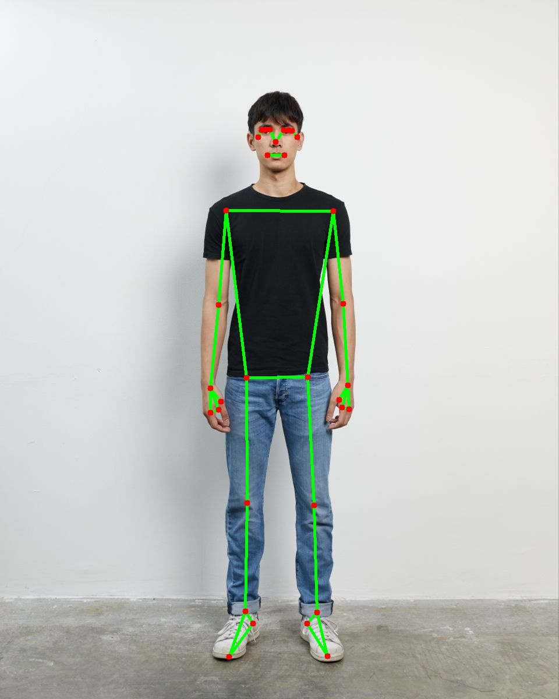
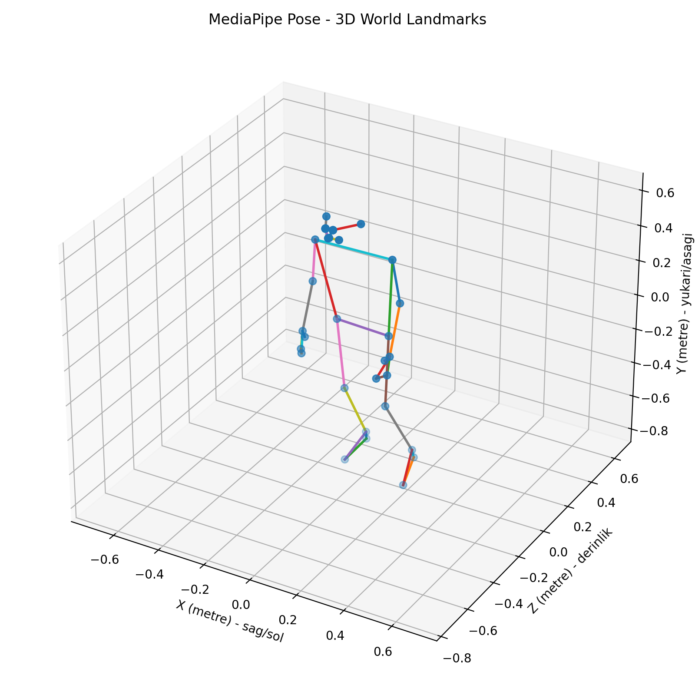
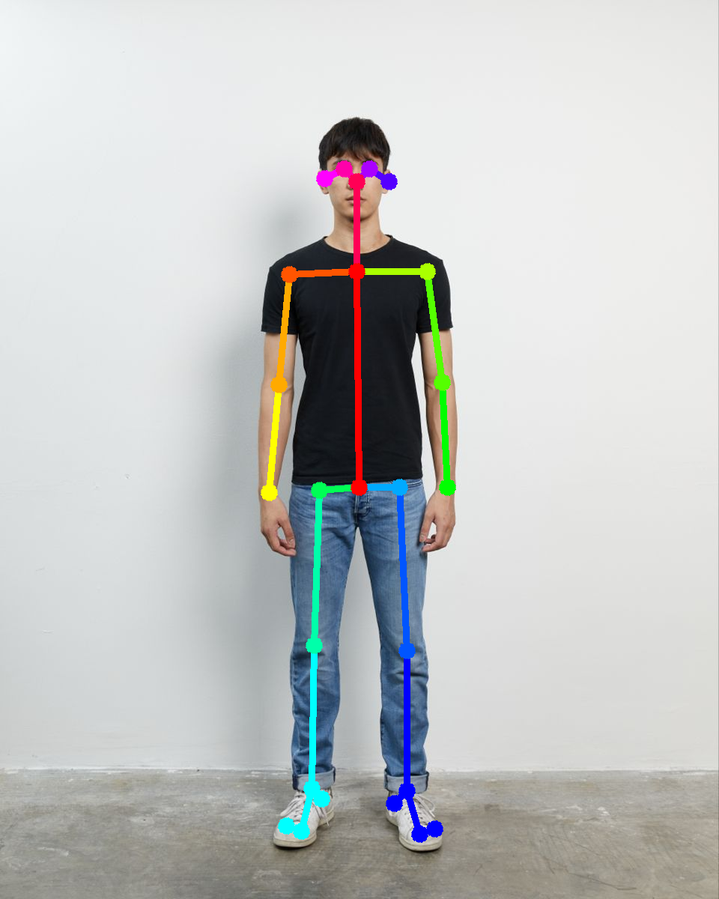
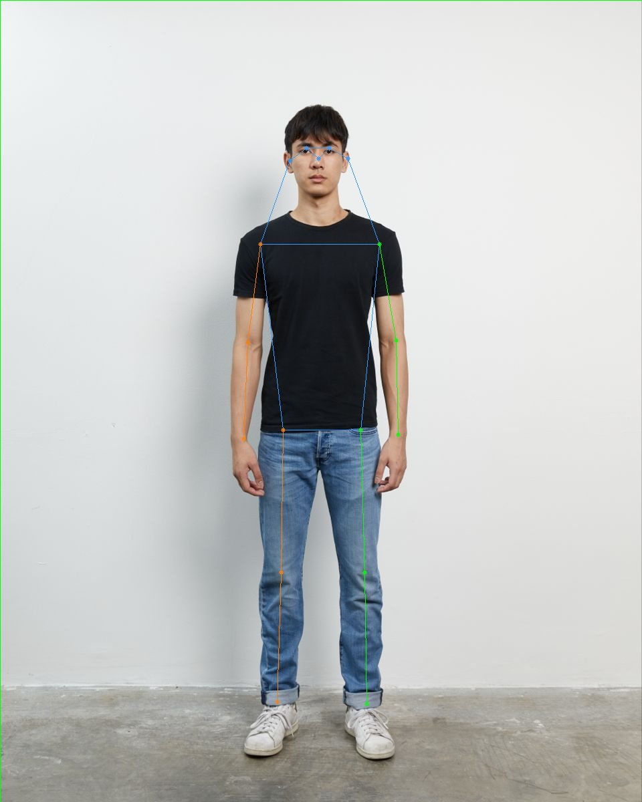
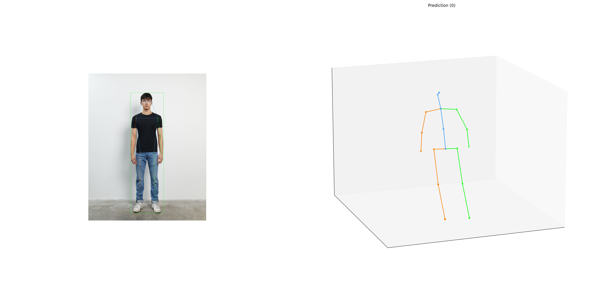

# Human Pose Analysis

Bu projede MediaPipe, OpenPose ve MMPose kullanılarak görüntü ve videolar üzerinde insan poz tahmini çalışmaları yapılmaktadır.

Amaç; görüntü veya videodan eklem noktalarını çıkarmak, bu noktaların zaman içerisindeki değişimini incelemek ve daha sonra hareket örüntülerini belirleyebilecek bir yapı oluşturmaktır.

Temel çalışma akışı:

```text
Image / Video
      ↓
Pose Estimation
      ↓
Landmarks / Keypoints
      ↓
Temporal Analysis
      ↓
Movement Pattern Recognition
```

Özellikle video tarafında, ileride sağa dönme, sola dönme, elini ağzına götürme veya ayağını kaldırma gibi hareketlerin keypoint değişimlerinden çıkarılması hedeflenmektedir.

---

## Kullanılan Yöntemler

### MediaPipe

MediaPipe Pose Landmarker kullanılarak 33 landmark üzerinden 2D ve 3D pose tahmini yapılmıştır.

Video işlemede her frame için landmark bilgileri çıkarılmakta ve CSV dosyasına kaydedilmektedir.

Kaydedilen temel bilgiler:

```text
frame
timestamp_ms
landmark_id
x
y
z
visibility
presence
```

<table>
<tr>
<td align="center"><b>MediaPipe 2D</b></td>
<td align="center"><b>MediaPipe 3D</b></td>
</tr>
<tr>
<td></td>
<td></td>
</tr>
</table>

---

### OpenPose

OpenPose BODY_25 modeli kullanılarak 25 keypoint üzerinden 2D pose tahmini yapılmaktadır.

OpenPose Apple Silicon üzerinde CPU_ONLY olarak derlenmiştir.

Video işlemede her frame için BODY_25 keypoint bilgileri JSON dosyalarına kaydedilmektedir.

<p align="center">
  
</p>

OpenPose bazı frame'lerde görünmeyen veya örtülü eklemleri tespit edemeyebilmektedir. Bu nedenle video çıktıları için basit bir temporal düzeltme adımı eklenmiştir.

Keypoint durumları:

```text
visible
interpolated
missing
```

Kısa süreli kayıplar lineer interpolation ile doldurulmaktadır.

Uzun süre görünmeyen keypointler ise yapay olarak üretilmeden `missing` olarak bırakılmaktadır.

---

### MMPose

MMPose tarafında:

- RTMDet ile insan tespiti
- RTMPose-M ile 2D pose tahmini
- SimpleBaseline3D ile 2D → 3D pose lifting

kullanılmıştır.

3D sonuçlar Human3.6M formatındaki 17 keypoint üzerinden elde edilmektedir.

<table>
<tr>
<td align="center"><b>MMPose 2D</b></td>
<td align="center"><b>MMPose 3D</b></td>
</tr>
<tr>
<td></td>
<td></td>
</tr>
</table>

---

## Video İşleme

MediaPipe ve OpenPose video işlemleri tek script üzerinden çalıştırılabilir.

Örnek kullanım:

```bash
./scripts/process_video.sh videos/input/walking_test.mp4 -1x256
```

İşlem sırasında:

```text
Video
 │
 ├── MediaPipe
 │    ├── Pose video
 │    └── Landmark CSV
 │
 └── OpenPose
      ├── Pose video
      ├── Frame JSON dosyaları
      └── Temporal düzeltme CSV
```

oluşturulmaktadır.

---

## OpenPose Temporal Düzeltme

OpenPose çıktılarında kısa süreli keypoint kayıplarını düzeltmek için temporal işlem uygulanmaktadır.

Örneğin bir bilek birkaç frame boyunca kaybolup tekrar bulunursa, aradaki noktalar önceki ve sonraki koordinatlar kullanılarak hesaplanmaktadır.

Uzun süre görünmeyen eklemler doldurulmamaktadır.

Bu sayede tespit edilemeyen bir keypoint doğrudan gerçek koordinatmış gibi kullanılmamaktadır.

Temporal sonuç tekrar video üzerine çizdirilebilir:

```bash
python scripts/render_openpose_temporal_video.py \
videos/input/walking_test.mp4 \
outputs/keypoints/openpose/walking_test_temporal.csv \
outputs/openpose_video/walking_test_temporal_pose.mp4
```

---

## Proje Yapısı

```text
Human_Pose_Analysis/
│
├── images/
│
├── videos/
│   └── input/
│
├── models/
│   ├── mediapipe/
│   └── mmpose/
│
├── outputs/
│   ├── keypoints/
│   ├── mediapipe_video/
│   └── openpose_video/
│
├── scripts/
│   ├── mediapipe_video.py
│   ├── openpose_video.sh
│   ├── openpose_temporal.py
│   ├── render_openpose_temporal_video.py
│   └── process_video.sh
│
├── external/
│   ├── openpose/
│   └── mmpose/
│
└── README.md
```

---

## Not

Model dosyaları, sanal ortamlar, harici kütüphaneler, giriş videoları ve otomatik üretilen büyük çıktı dosyaları repoya dahil edilmemektedir.
