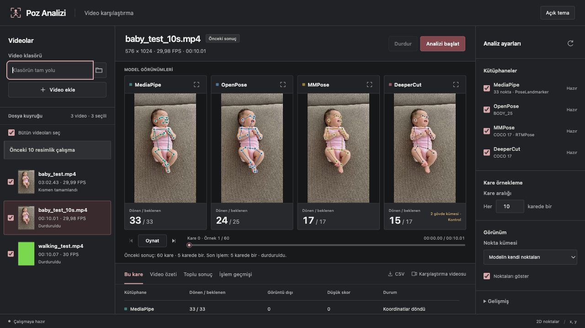

# Human Pose Analysis

Bu projede staj çalışmam kapsamında MediaPipe, OpenPose, MMPose ve DeeperCut'ın bebek görüntülerinde çıkardığı vücut noktalarını karşılaştırıyorum. Hocamın yönlendirmesiyle aşama aşama ilerliyorum. Önce noktaların nasıl çıkarıldığını ve sonuçların nasıl karşılaştırılacağını çalıştım; ardından bu noktalardan CSV verileri hazırladım.

## 1. İlk video karşılaştırması

`baby_test.mp4` üzerinde MediaPipe, OpenPose ve MMPose'u tam videoda, DeeperCut'ı ilk 10 saniyede çalıştırdım. Dört yöntemin aynı bölümdeki sonuçlarını [karşılaştırma videosunda](outputs/baby_test_10s_comparison.mp4) birleştirdim.

## 2. Resimlerden özellik çıkarma

Test videosundan beş sırtüstü (SUPINE), beş yan yatış (SIDE_LYING) örneği seçtim. Bu pozisyon adları resim seçimi için kullandığım gözlem notlarıdır; model tahmini değildir.

Dört kütüphanede sağ ve sol omuz, dirsek, el bileği, kalça, diz ve ayak bileğini eşledim. Aynı 12 eklem için yalnız x,y kullandım; z değerini almadım.

Her resim için üç şekilde özellik çıkardım:

1. **Koordinatlar:** 24 x,y değeri, piksel cinsinden.
2. **Açılar:** Kosinüs teoremiyle hesaplanan 12 eklem ve gövde açısı.
3. **Oranlar:** 21 mesafenin gövde uzunluğuna oranı. Referans olarak omuzların orta noktası ile kalçaların orta noktası arasındaki mesafeyi kullandım.

Her kütüphane için üç ayrı CSV ve bu 57 özelliği bir arada tutan bir birleşik CSV oluşturdum. Her resim bir satırdır. Hazır pose modellerini kullandım; bu resim çalışmasında yeni bir sınıflandırıcı eğitmedim ve noktaları elle düzeltmedim. Bulunamayan noktaları ve bunlara bağlı hesaplanamayan değerleri boş bıraktım.

[10 resimlik örnek sonuçlar](outputs/image_feature_datasets/final_pilot_v2_release/) ve [özellik çıkarma kodunun kullanım notları](docs/image_feature_dataset_v2.md) depoda bulunuyor.

## 3. Video karşılaştırma arayüzü

Karşılaştırmayı farklı videolarda da yapabilmek için yerel bir arayüz hazırladım. Bir klasördeki videoları listeleyip sırayla işletebiliyorum. Hangi kütüphanelerin çalışacağını ve kaç karede bir örnek alınacağını arayüzden seçiyorum. Örneğin kare aralığını 5 seçtiğimde 0, 5, 10, 15 şeklinde ilerliyor; bu ayar videonun FPS değerini değiştirmiyor.



Her kütüphaneye aynı örnek kareyi veriyorum ve sonuçları yan yana gösteriyorum. Varsayılan görünümde MediaPipe'ın 33, OpenPose BODY_25'in 25, MMPose ve DeeperCut'ın COCO düzenindeki 17 noktası kullanılıyor. Önceki resim çalışmasıyla karşılaştırabilmek için ortak 12 eklemi gösteren ayrı bir seçenek de var.

Arayüzde bu karede kaç noktaya koordinat döndüğünü, düşük skorları ve görüntü dışına düşen noktaları inceleyebiliyorum. Video özeti ve toplu sonuçları da görebiliyor, sayımları CSV ve karşılaştırmayı MP4 olarak kaydedebiliyorum. Görüntüleri büyütme, noktaları gizleme ve açık/koyu tema seçeneklerini ekledim.

Buradaki nokta sayısı **doğruluk oranı değil**. Bir noktanın koordinatının dönmesi, anatomik olarak doğru yere konduğunu göstermiyor. Kütüphanelerin skorları da aynı anlama gelmiyor. Bu yüzden sayımların yanında çizimleri de kontrol ediyorum. Bu arayüz şu anda nokta çıkarma sonuçlarını karşılaştırıyor; SUPINE veya SIDE_LYING tahmini üretmiyor.

## Çalıştırma

Arayüzü mevcut macOS çalışma ortamımda şu komutla açıyorum:

```bash
.venv_mediapipe/bin/python -B app/pose_comparison_v1/server.py --port 8765
```

Tarayıcı adresi: `http://127.0.0.1:8765`. Terminalde `Ctrl+C` ile kapatılabilir.

Çalıştırmak için MediaPipe ve MMPose Python ortamları, model ağırlıkları, OpenPose kurulumu ve FFmpeg gerekiyor. DeeperCut için ayrıca Docker'ın çalışması ve yerel `pose-tf14:latest` imajının bulunması gerekiyor; yalnızca Docker'ı açmak yeterli değil. Bu ortamlar, ağırlıklar ve girdi videoları GitHub'a dahil değil, bu yüzden depoyu indirmek tek başına dört kütüphaneyi çalıştırmaya yetmiyor.

Arayüz kodları [app/pose_comparison_v1](app/pose_comparison_v1/) klasöründe, video işleme kodu [pose_video_comparison_v1.py](scripts/pose_video_comparison_v1.py) dosyasında. Arayüzün ürettiği karşılaştırmalar `outputs/library_comparison_app/runs/`, işlem kayıtları ise `outputs/library_comparison_app/` altında yerelde tutuluyor.

## Kontroller

Resim çalışmasında CSV değerlerini ham noktalarla ve ayrı açı/mesafe hesaplarıyla kontrol ettim. MediaPipe ve MMPose 120 ortak noktanın tamamında, OpenPose 119'unda, DeeperCut 75'inde sayısal değer verdi. Bu, 10 resimlik küçük bir denemenin nokta doluluğu; bağımsız test başarısı olarak değerlendirmiyorum. Yüksek görünürlük değeri de noktanın doğru yerleştiğini garanti etmiyor. Açı ve oranlar eşit ölçeklemeye dayanıklı olsa da kamera açısı değiştiğinde değişebilir.

Video işleme ve yerel sunucu için yazdığım otomatik kontroller; örnekleme, nokta eşleme, sayım, kayıt ve yarıda kalan işlemler gibi yazılım davranışlarını denetliyor. Bunlar modellerin noktaları doğru yere koyduğunu ölçen testler değil.

```bash
.venv_mediapipe/bin/python -B scripts/test_pose_video_comparison_v1.py
.venv_mediapipe/bin/python -B scripts/test_pose_comparison_server_v1.py
```

## Devamında ne yapacağım?

Şu an önceliğim kütüphanelerin nokta çıkarma sonuçlarını karşılaştırmak ve hatalı yerleşimleri incelemek. Sonrasında etiketli verilerden x,y koordinatlarını, açıları ve uzunluk oranlarını CSV olarak çıkaracağım. Video örneklerinde zaman sırasını da koruyacağım.

Bu verileri daha sonra MLP, SVM gibi sınıflandırıcılara vererek pozisyon ve hareket tanımayı deneyeceğim. Eğitim ve test verilerini ayırıp sonuçları confusion matrix ve ROC eğrileriyle değerlendireceğim. Karşılaştırma, özellik çıkarma ve sınıflandırma aşamalarını bu sırayla ele alıyorum; mevcut arayüzde sınıflandırıcı eğitimi yapmıyorum.
